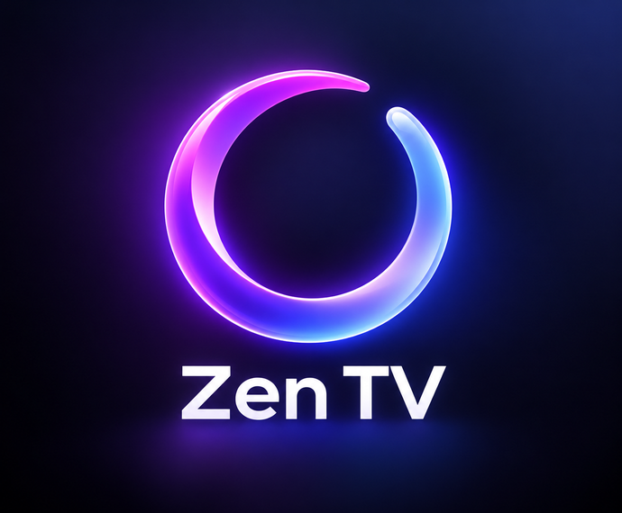

<p align="center"></p>

# Zen TV

A calm, Apple TV–style home screen for Samsung smart TVs: your streaming apps in one row over
beautiful landscapes, with optional movie and show recommendations. No ads, no clutter.

Made by Emmanuel Pozo ([@princepozo](https://x.com/princepozo)).

> **Tried on one TV only.** I built this for my own TV, a 2018 Samsung (UN65NU8000) running Tizen 4.0,
> and that's the only one it has been tested on. Other Samsung TVs running Tizen will probably work, but
> I can't promise it. It installs like any developer app (no rooting or hacking), and you can remove it
> from the TV's Apps at any time.

## What it does

- **Your apps** in one row, ordered by what you use most
- **Landscape backgrounds**, or movie and show scenes when recommendations are on
- **Recommendations** (optional): Trending, Classics, Watch Later and voice search
- **Profiles** for everyone in the house
- **Five themes**: Glass, Midnight, Paper, Cinema and Nature
- **Controls**: switch the TV's input or open its settings
- Opens when the TV turns on, and comes back when you leave an app (optional)

## What you need

- A Samsung smart TV running Tizen, on the same Wi-Fi as your computer
- A Mac or Linux computer with Python 3 (Windows isn't supported yet)
- [Tizen Studio](https://developer.samsung.com/smarttv/develop/getting-started/setting-up-sdk/installing-tv-sdk.html)
  (free), and a free Samsung account for the certificate
- Optional: a free [TMDB](https://www.themoviedb.org/settings/api) key for recommendations, and the
  SmartThings app to open Zen TV at power-on

## Install

```bash
git clone https://github.com/Jewgonewild/zen-tv.git
cd zen-tv
python3 install.py
```

The installer opens in your browser and walks you through everything: name and icon, theme,
profiles, your apps, then Developer Mode and your Samsung certificate, and installing. The
certificate is the slow part (allow 30 to 60 minutes the first time). Everything saves as you go, so
you can stop and come back, and you can run it again later to change anything.

It only runs on your computer, and your keys stay in `~/.zen-tv`, never in this folder.

### Or let your AI agent set it up

You can also hand this repo to a coding agent such as Claude Code, Codex, Grok or Muse. Open the
folder in it and ask something like:

> Set up Zen TV on my Samsung TV using this repo's README. Walk me through the steps I have to do
> myself (Developer Mode and the Samsung certificate) and run the rest.

You'll still do a few things by hand (the TV's Developer Mode, signing in to Samsung for the
certificate, choosing Allow on the TV), and your agent will tell you when.

## Using it

| | |
| --- | --- |
| Open an app | Left/Right, then OK. Back while it's loading cancels |
| Recommendations | Down from the apps: Trending, Classics, Watch Later |
| Switch profile | Up, then OK on your name (top left) |
| Inputs and TV settings | Up, then Right to **Controls** |
| Search | Up, then Right past Controls (with recommendations on) |
| Go back | Back |

## Good to know

- The remote's Home button still opens Samsung's bar; no app can replace it. Zen TV opens at power-on
  and when you leave an app, so you rarely see Samsung's.
- "Open in Netflix" (and the like) opens the app's home screen, not the title itself: Samsung doesn't
  let one app open a specific title in another.
- Samsung certificates expire after a few years. When yours does, make a new one and install again.
- With recommendations on, your TMDB key is stored inside the app on your TV, so it can fetch titles.

## Troubleshooting

- **Install fails:** check Developer Mode is on with this computer's current IP, that the TV was
  restarted afterwards, and that the certificate was made with the TV connected.
- **An app tile doesn't open:** its ID may differ on your TV. Read your apps again in the installer.
- **A tile shows a name instead of a logo:** read your apps again with the TV on, or reinstall.
- **Zen TV doesn't come back after leaving an app:** open it once from Apps.

<details>
<summary><b>Setting it up by hand</b> (what the installer does for you)</summary>

```bash
python3 -m venv .venv && . .venv/bin/activate
pip install -r requirements.txt
cp settings.example.json settings.json        # then edit it (all settings below)
mkdir -m 700 -p ~/.zen-tv
pbpaste > ~/.zen-tv/tmdb-key && chmod 600 ~/.zen-tv/tmdb-key   # optional: your TMDB key, copied first
```

1. **Developer Mode:** on the TV, open Apps and type `1 2 3 4 5` (or use the SmartThings app's
   number pad). Turn Developer mode on, enter this computer's IP, and restart the TV.
2. **Certificate:** in Tizen Studio, connect the TV in Device Manager, then Certificate Manager → **+**
   → Samsung → TV. Name the profile as in `certificateProfile`, create the author certificate, sign in
   with your Samsung account, and create the distributor certificate (privilege: Public).
3. **Your apps** (TV on): `python3 scripts/zentv.py pair` (choose Allow on the TV), then
   `python3 scripts/zentv.py apps` to see each app's key for `apps`, then `python3 scripts/zentv.py icons`.
4. **Install:** `scripts/deploy.sh` (or `scripts/deploy.sh --no-open` so nothing on screen is
   interrupted).
5. **Open at power-on** (optional): make a SmartThings token at
   <https://account.smartthings.com/tokens> (Devices, Locations, Rules), save it as
   `~/.zen-tv/st-token`, and run `python3 scripts/zentv.py poweron`. Then on the TV, turn off
   Settings → General → Smart Features → Autorun Smart Hub.

To preview on your computer: `scripts/preview.sh`, then open <http://localhost:5178> (arrows, Enter =
OK, Escape = Back).

</details>

<details>
<summary><b>All settings</b> (<code>settings.json</code>)</summary>

| Setting | What it does |
| --- | --- |
| `appName` | The name in the TV's app list and the Controls menu |
| `icon` | `zen`, `dawn`, `night`, `lake`, or `custom` (your upload, in `~/.zen-tv/icon.png`) |
| `theme` | `glass` (default), `midnight`, `paper`, `cinema` or `nature` |
| `recommendations` | `true` (default) or `false` for just your apps over landscapes |
| `tvIp` | The TV's IP address |
| `certificateProfile` | Your Tizen Studio certificate profile |
| `tizenStudio` | Where Tizen Studio is installed |
| `tmdbKeyFile` | The file holding your TMDB key |
| `region` | Two-letter country code, for what streams where |
| `weather` | `latitude`, `longitude` and `units` (`fahrenheit` or `celsius`); leave out for no weather |
| `clock24h` | `true` for a 24-hour clock |
| `backgroundSeconds` | How long each background stays |
| `apps` | The app row, by key (`python3 scripts/zentv.py apps` lists them) |
| `alsoInstalled` | Apps titles can open in, without a tile |
| `profiles` | One per person: `{ "name": "Eloise", "initial": "E", "color": "purple", "taste": "crime-drama" }` |

A profile's `color` is `purple`, `pink`, `blue`, `green`, `orange` or `teal`; its `taste` is
`crime-drama` or `romance-comedy`, and Watch Later saves tune it from there. An app that isn't in the
catalog can be added as `{ "key": "crunchyroll", "name": "Crunchyroll", "store": "<store ID>" }`.

</details>

## Credits and licence

The code is MIT licensed. Landscape photos are from Wikimedia Commons, and the fonts are Inter,
Fraunces and Playfair Display; their licences are in [NOTICE.md](NOTICE.md). Movie and TV data and
images come from [TMDB](https://www.themoviedb.org): this product uses the TMDB API but is not endorsed
or certified by TMDB. Weather by [Open-Meteo](https://open-meteo.com).

Zen TV is an independent project, not affiliated with Samsung or any streaming service.

If Zen TV makes your TV a nicer place, you can say thanks on Venmo: **@epozo**.
